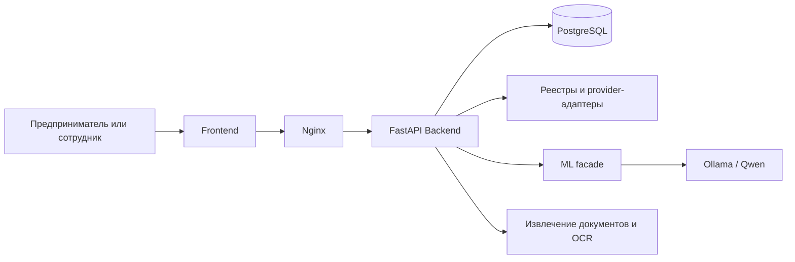

# Smart Credit Cabinet

Демонстрационный кредитный кабинет для предпринимателей, проект для Альфа Хак. Он показывает путь от регистрации и сведений о компании до заявки, AI-оценки и ручной проверки.

> Это прототип, а не банковский продукт. Каталог, ставки, расчёты и исходы модели демонстрационные. Их нельзя использовать как реальное кредитное предложение или кредитную политику.

## Попробовать онлайн

**Сайт уже работает: [открыть Smart Credit Cabinet →](https://176.123.165.51/)**

Протестировать кабинет можно прямо в браузере — без скачивания проекта и локального развёртывания. Зарегистрируйте аккаунт и попробуйте возможности сервиса.

## Видео проекта

[](https://176.123.165.51/demo/)

**[Смотреть полное видео со звуком →](https://176.123.165.51/demo/)** · [MP4 в репозитории](frontend/demo/credit-demo.mp4)

Две минуты о компании, импорте отчётности с Qwen, расчёте кредита, заявках, мобильном интерфейсе и админ-панели. В финале — реальные CI/CD и Nuclei. **1080p · 60 кадров/с · русские титры и музыка.** Пользовательские и финансовые данные в ролике вымышлены; интерфейс и ответы API настоящие. Снята версия `489fd4d`.

## О проекте

Кабинет собирает в одном интерфейсе данные компании, финансовый профиль, кредитную историю и заявку на финансирование. Предприниматель может проверить предварительный расчёт, отправить заявку и увидеть её статус. Если ответ модели требует проверки, заявка попадает сотруднику с ролью `REVIEWER`; администратор управляет доступами и видит аудит.

Публичный интерфейс работает через FastAPI API. Бизнес-состояние хранится в PostgreSQL, изменения схемы применяются Alembic. Ollama с Qwen запускается локально в Docker; модель не вызывается через облачный API.

## Возможности кабинета

### Предпринимателю

- Создать аккаунт, войти по JWT и привязать компанию по ИНН.
- Просмотреть реквизиты и доступные сведения о компании, финансах и кредитной истории.
- Обновить финансовые показатели вручную или запросить обновление из подключённого источника.
- Посмотреть каталог продуктов и запросить предварительный расчёт по сумме, сроку и цели. Расчёт выбирает подходящий продукт, показывает ставку, платёж и общую переплату по демонстрационным правилам.
- Создать черновик, изменить его до отправки, смотреть статус заявки, решение и историю действий.
- Загрузить отчётность, проверить извлечённые значения и подтвердить только те данные, которые следует сохранить.

### Сотрудникам

- `REVIEWER` видит очередь заявок `MANUAL_REVIEW`, исход AI и версии данных. Он может подтвердить или отклонить условное решение и оставить комментарий. Решение сотрудника хранится отдельно от рекомендации модели.
- `ADMIN` видит сводку по пользователям, компаниям и заявкам, управляет ролями `USER`/`REVIEWER`, блокирует аккаунты и просматривает журнал административных действий.
- Панель сотрудников: http://localhost:8080/#/admin. Публичная регистрация не позволяет назначить роль `REVIEWER` или `ADMIN`; первый администратор создаётся серверной командой.

## Как проходит заявка

1. Пользователь выбирает продукт или категорию, указывает сумму, срок, цель и дополнительную информацию. Backend проверяет, что сумма и срок попадают в лимиты продукта.
2. При создании и отправке заявки сохраняется snapshot — неизменяемая копия данных, использованных в этой попытке. Позднее изменение профиля компании не переписывает историю заявки.
3. ML-фасад получает данные snapshot, выбранный продукт и его ограничения, сумму, срок и цель. Числовой `risk_score` рассчитывается отдельными прозрачными правилами; Qwen предлагает один из исходов `APPROVED`, `CONDITIONAL_APPROVAL` или `REJECTED`, объяснение, факторы, рекомендацию и следующий шаг.
4. Backend проверяет формат ответа и жёсткие ограничения продукта, сохраняет исход, источник (`AI` или `Fallback_Rules`) и аудит. При недоступности Ollama тот же формат ответа формируют запасные правила.
5. Условная рекомендация переводит заявку в `MANUAL_REVIEW`. Сотрудник принимает отдельное решение; только после него заявка переходит в `DECISION` или `REJECTED`.

Если выручка равна нулю, система не вызывает модель: заявка получает `NEED_MORE_DATA`. Пользователь может исправить финансовые данные и отправить заявку повторно; каждая попытка сохраняется отдельной версией snapshot. Официальная дата регистрации компании не редактируется пользователем.

### AI и ограничения решения

Qwen 3.5 4B — локальная языковая модель, не обученная и не откалиброванная для оценки кредитоспособности. Она формирует демонстрационную рекомендацию на основе переданных данных; `risk_score` сам по себе не является вероятностью дефолта. При недоступности модели работает `Fallback_Rules`. Источник результата нужно смотреть отдельно: HTTP 200 не означает, что ответ сформировала LLM.

Backend не принимает от модели ставку, окончательный размер оффера или договорные условия. Smart pricing считает предварительные параметры по продукту и версии правил `demo-v1`; в расчёте нет комиссий, страховок и дополнительных услуг. Формальные банковские предложения и договоры в проекте не оформляются.

## Данные и происхождение

| Источник | Что используется | Оговорки |
| --- | --- | --- |
| DaData | Реквизиты компании и доступные по тарифу финансовые показатели | Нужен серверный `DADATA_API_KEY`. Ключ не открывает автоматически всю бухгалтерскую отчётность. |
| Ручной ввод | Финансовые показатели, которые обновляет пользователь | Источник и время изменения сохраняются; ручные сведения не считаются подтверждёнными банком или госорганом. |
| Импорт документов | PDF, изображения, XLSX, DOCX, CSV/TSV, XML, TXT и JSON | Backend извлекает текст/OCR и предлагает поля с цитатами. Пользователь проверяет и подтверждает результат; исходный файл удаляется после обработки. |
| Шлюз кредитной истории | Агрегированные данные БКИ через HTTPS-шлюз организации | Нужны настроенный шлюз и согласие пользователя. Прямой интеграции с бюро нет. |
| Demo providers | Синтетические данные компании, финансов и кредитной истории | Для полностью демонстрационного режима задайте `DATA_MODE=demo` в `.env`. |
| Каталог и smart pricing | Demo-продукты, лимиты и предварительная смета | Ставки и смета не являются оффером банка. |

По умолчанию используется `DATA_MODE=real`. Если реальный источник не подключён или не предоставляет конкретное поле, значение остаётся неизвестным; система не должна незаметно подставлять вместо него синтетические данные. При пустом `DADATA_API_KEY` сведения о компании берёт demo-provider, а финансовые и кредитные providers в real-режиме могут вернуть недоступные поля.

Подробности: [источники финансовых данных](docs/financial-data.md) и [импорт документов](docs/document-import.md).

## Архитектура

Frontend на HTML, CSS и JavaScript отдаёт Nginx. Nginx раздаёт кабинет и проксирует API-запросы в FastAPI. Backend разделён на модули для авторизации, компании, финансов, продуктов, заявок, review и документов. PostgreSQL хранит профиль, snapshot’ы, решения и аудит; Alembic управляет схемой.



## Локальный запуск

Нужны Docker Engine, Docker Compose v2+, GNU Make и Python 3. На чистом клоне есть зашифрованная серверная конфигурация, поэтому для локальной разработки создайте отдельный `.env` со случайными секретами:

```bash
make init INIT_ENV_ARGS=--fresh-local
```

Чтобы пройти сценарий на синтетических данных без внешних ключей, установите `DATA_MODE=demo` в созданном `.env`. Затем запустите CPU-версию:

```bash
make up
```

С NVIDIA GPU и установленным NVIDIA Container Toolkit:

```bash
make up-gpu
```

Только API, PostgreSQL и Nginx без Ollama:

```bash
make up-core
```

Первый запуск полного стека скачивает контейнерные образы и модель `qwen3.5:4b`; ей требуется несколько гигабайт диска. PostgreSQL и модель сохраняются в Docker volumes.

- Кабинет: http://localhost:8080
- Панель сотрудников: http://localhost:8080/#/admin
- Swagger: http://localhost:8080/docs
- API: http://localhost:8080/api/v1
- Readiness Backend и PostgreSQL: http://localhost:8080/api/v1/ready

Остановить сервисы, сохранив данные:

```bash
make down
```

## Проверки и тесты

Из корня репозитория:

```bash
make test       # Backend-тесты и миграции на временной PostgreSQL
make check      # HTTP smoke через Nginx: API, БД, Swagger, регистрация и вход
make check-ml   # Живой ответ Qwen; ожидается source=AI
make build      # Сборка Backend
```

`make check` создаёт demo-пользователя в локальной БД. `make check-ml` также создаёт тестовую компанию и сохраняет данные в локальной БД. Пароли и JWT скрипты не выводят.

Frontend проверяется отдельно:

```bash
cd frontend
npm ci
npm run check
npm test
```

CI запускает проверки синтаксиса Python и Frontend, безопасности и зависимостей, `pip check`, Alembic drift, Backend-тесты и HTTP smoke. Для `main` настроен отдельный CD workflow; production-развёртывание включается только после настройки GitHub environment и сервера.

## Секреты и сервер

Локальный `.env` исключён из Git; серверная конфигурация хранится в зашифрованном SOPS-файле, а приватный age-ключ — вне репозитория. Серверные команды и процесс развёртывания описаны в [документации по секретам](docs/secrets.md) и [CD-runbook](docs/cd.md).

## Структура репозитория

| Каталог | Содержимое |
| --- | --- |
| `frontend/` | Кабинет предпринимателя и панели сотрудников; исходники без отдельного production build step. |
| `backend/` | FastAPI, бизнес-логика, PostgreSQL-модели, миграции Alembic и тесты. |
| `ml/` | Rule-based risk score, фасад, prompt, структурированная схема ответа и fallback. |
| `data/` | Генератор синтетических наборов; CSV автоматически не загружаются в БД. |
| `devops/` | Compose/Nginx, CI/CD, SOPS, эксплуатация, резервные сценарии и DAST. |
| `docs/` | API, источники данных, импорт документов, ML, безопасность и deployment. |

## Документация

- [API и статусы заявок](docs/api.md)
- [Frontend](frontend/README.md)
- [Backend](docs/backend.md)
- [ML-фасад, признаки и fallback](docs/ml.md)
- [Источники финансовых данных](docs/financial-data.md)
- [Импорт документов](docs/document-import.md)
- [Панель сотрудников](docs/admin-console.md)
- [Запуск и инфраструктура](docs/devops.md)
- [CI/CD](docs/cd.md)
- [Секреты и SOPS](docs/secrets.md)
